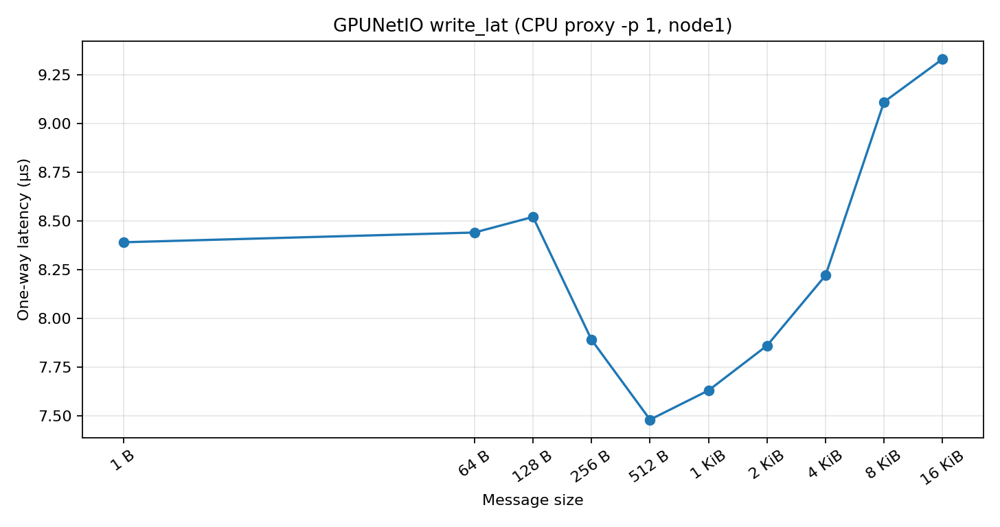
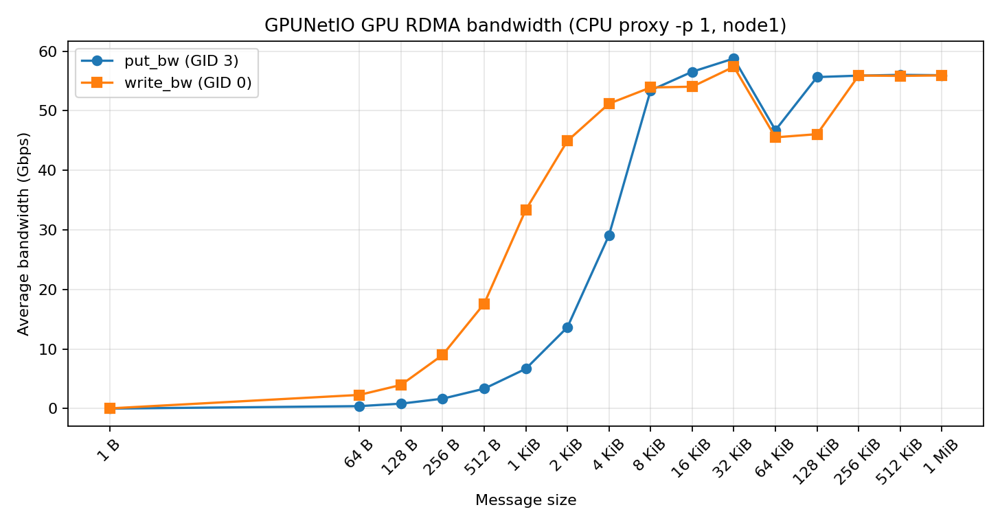

# EE542 Lab 8 Report

## Overview

We implemented and tested a pipeline that converts a pretrained CNN to TensorRT, represents images as UDP packets, reconstructs the images using DPDK, and classifies the reconstructed images on the GPU. We also built and tested NVIDIA DOCA GPUNetIO samples to examine the requirements for direct network access to GPU memory.

Parts 1–5 were performed on a local NVIDIA GPU under WSL2. Part 6 was also tested locally using Docker Desktop instead of the cloud VM specified in the handout. This environment difference is reported explicitly. The Part 6 results demonstrate successful compilation and identify runtime device limitations; they do not demonstrate successful GPU network communication.

Part 7 ran on two CloudLab A30/ConnectX-6 hosts using CPU-proxy GPUNetIO. It measured GPU-memory RDMA latency and bandwidth against a CPU-memory baseline and recorded the UDP steering and direct GPU-doorbell limitations.

## Part 1: Environment Setup

The project was developed in VS Code, with Python dependencies installed in a project-specific virtual environment.

| Component | Configuration |
|---|---|
| GPU | NVIDIA GeForce RTX 5070 |
| GPU memory reported by nvidia-smi | 12,227 MiB |
| Compute capability | 12.0 |
| Operating system | Ubuntu 24.04 under WSL2 |
| NVIDIA kernel-mode driver version | 617.42 |
| NVIDIA-SMI version | 615.78.05 |
| CUDA UMD version reported by nvidia-smi | 13.4 |
| Host CUDA Toolkit | 13.1 |
| PyTorch | 2.11.0+cu128 |
| torchvision | 0.26.0+cu128 |
| TensorRT | 11.4.0.106 |
| DPDK | 23.11.4 |
| Scapy | 2.8.0 |
| DOCA | 3.5.0098 |
| CUDA Toolkit inside the DOCA container | 13.0 |

The host toolkit, PyTorch CUDA build, and container toolkit are separate software components, so their version numbers differ. The CUDA UMD version reported by `nvidia-smi` is not the installed toolkit version.

The environment supported GPU inference, TensorRT engine construction, DPDK PCAP reception, and compilation of the DOCA samples.

Evidence: [Python dependencies](requirements.txt), [GPU and driver information](logs/nvidia-smi.txt), and [CUDA compiler information](logs/nvcc.txt).

## Part 2: TensorRT Inference from GPU Memory

### Implementation

We used pretrained torchvision ResNet-18 and exported separate FP32 and FP16 ONNX models with a dynamic batch dimension. TensorRT engines used an optimization profile with batch sizes of 1, 8, and 32 as the minimum, optimal, and maximum values.

The inference runner allocated input and output tensors in GPU memory and passed their device pointers to TensorRT using `set_tensor_address`. Inference was submitted through `execute_async_v3` on a CUDA stream. Tensor data types matched the engine requirements, and execution was synchronized before reading results.

The FP16 engine was built from the FP16 ONNX model, following TensorRT 11's strongly typed workflow.

### Benchmark Results

Measurements used 50 warm-up iterations followed by 200 timed iterations. CUDA events measured GPU execution time.

| Batch | Implementation | Latency (ms) | Throughput (images/s) | Speedup |
|---:|---|---:|---:|---:|
| 1 | PyTorch FP32 | 1.9484 | 513.2 | 1.00× |
| 1 | TensorRT FP32 | 0.8331 | 1,200.4 | 2.34× |
| 1 | TensorRT FP16 | 0.2937 | 3,404.8 | 6.63× |
| 8 | PyTorch FP32 | 3.4753 | 2,301.9 | 1.00× |
| 8 | TensorRT FP32 | 1.5483 | 5,166.8 | 2.24× |
| 8 | TensorRT FP16 | 0.5280 | 15,152.7 | 6.58× |
| 32 | PyTorch FP32 | 7.6124 | 4,203.7 | 1.00× |
| 32 | TensorRT FP32 | 5.1113 | 6,260.6 | 1.49× |
| 32 | TensorRT FP16 | 1.6769 | 19,082.3 | 4.54× |

Calculations:

- Speedup = PyTorch latency / TensorRT latency.
- Throughput = batch size × 1,000 / latency in milliseconds.

TensorRT FP16 achieved the lowest latency at every tested batch size. Its highest measured throughput was approximately 19,082 images/s at batch 32. Increasing the batch size improved throughput but increased the time required to process each batch.

### Numerical Consistency

Each engine was compared with PyTorch FP32 on the same input.

| Batch | TensorRT FP32 maximum absolute logit error | TensorRT FP16 maximum absolute logit error | FP32 top-1 agreement | FP16 top-1 agreement |
|---:|---:|---:|---:|---:|
| 1 | 0.003281 | 0.014122 | 100% | 100% |
| 8 | 0.004418 | 0.021438 | 100% | 100% |
| 32 | 0.006119 | 0.028236 | 100% | 100% |

FP16 produced larger numerical differences, but the top-1 predictions matched PyTorch for all tested inputs. TensorRT FP32 retained its default configuration, which may permit TF32 operations.

These comparisons used random inputs and establish agreement on those inputs, not classification accuracy on a labeled dataset. The timings measure inference on GPU-resident buffers, excluding packet reception and host-to-device transfers.

Evidence: [benchmark results](results/part2_benchmark.csv).

## Part 3: Images as UDP Packets

We generated 16 synthetic RGB images, each with dimensions 224 × 224. Each image contained:

`224 × 224 × 3 = 150,528 bytes`

Each UDP payload contained a 22-byte application header followed by up to 1,400 bytes of image data.

| Header field | Size | Purpose |
|---|---:|---|
| magic | 4 bytes | Identifies the application packet format |
| frame_id | 4 bytes | Identifies the image |
| seq | 2 bytes | Identifies the segment |
| nseg | 2 bytes | Specifies the total segment count |
| offset | 4 bytes | Specifies the destination offset within the image |
| length | 2 bytes | Specifies the image bytes in this packet |
| frame_bytes | 4 bytes | Specifies the complete image size |

Each image required:

`ceil(150,528 / 1,400) = 108 packets`

The final packet contained 728 image bytes. Therefore, 16 images produced 1,728 packets.

The largest IPv4 packet occupied:

`20 + 8 + 22 + 1,400 = 1,450 bytes`

This includes the IPv4 header, UDP header, application header, and image chunk. It fits within a 1,500-byte IP MTU; Ethernet framing is additional to that MTU.

We saved the original images and generated both ordered and shuffled PCAP files. A separate robustness test added 100 duplicate packets.

Evidence: [packet generator](src/generate_pcap.py), [duplicate generator](src/generate_duplicates.py), and [generation log](logs/generate_pcap.txt).

## Part 4: DPDK Reception and Image Reassembly

### Receiver Design

The C receiver used DPDK's PCAP virtual port to process packets without requiring a physical high-speed NIC.

The receiver validated Ethernet, IPv4, UDP, and application headers, checked the destination port, interpreted network-byte-order fields, and validated chunk boundaries before copying data.

Chunks were placed according to their frame IDs and byte offsets. Segment tracking allowed arbitrary arrival order and prevented duplicate chunks from being counted more than once.

The PCAP port does not provide an explicit end-of-file notification. The receiver therefore used a two-second inactivity timeout, allowing it to process trailing duplicate packets before stopping. This is an offline-test heuristic rather than a general completion rule for live traffic.

### Results

| Test | Packets received | Accepted chunks | Invalid/unrelated packets dropped | Duplicate chunks ignored | Complete frames |
|---|---:|---:|---:|---:|---:|
| Ordered | 1,728 | 1,728 | 0 | 0 | 16/16 |
| Shuffled | 1,728 | 1,728 | 0 | 0 | 16/16 |
| With duplicates | 1,828 | 1,728 | 0 | 100 | 16/16 |

For ordered and shuffled inputs, the reconstructed output contained 2,408,448 bytes and matched the original data byte for byte. The original and reconstructed SHA-256 hashes also matched.

The duplicate test completed all 16 frames while ignoring exactly 100 repeated chunks. Its downstream classification results were also identical to those of the original images.

These tests validate ordered, shuffled, and duplicate handling. They do not establish behavior under every malformed-packet or packet-loss condition.

Evidence: [receiver source](src/dpdk_rx.c), [byte-level verification](results/part4_verification.json), and [duplicate-test log](logs/dpdk_duplicates.txt).

## Part 5: Classifying Reconstructed Images

### GPU Processing

The reconstructed images were staged in pinned CPU memory and copied to the GPU. Preprocessing was performed on the GPU using the transforms associated with the pretrained ResNet-18 weights:

- Conversion from HWC image bytes to channel-first tensors.
- Resizing to 256 and center cropping to 224 × 224.
- Conversion to floating-point values and normalization.
- Conversion to FP16 for TensorRT inference.

Normalization used mean `[0.485, 0.456, 0.406]` and standard deviation `[0.229, 0.224, 0.225]`.

Original and reconstructed images were evaluated using the same preprocessing and FP16 engine.

| Input mode | Matching top-1 predictions | Maximum absolute logit difference |
|---|---:|---:|
| Ordered | 16/16 | 0 |
| Shuffled | 16/16 | 0 |
| Duplicate packets | 16/16 | 0 |

All reconstructed images produced the same classifications and logits as their originals. Because the images were synthetic, this result demonstrates pipeline consistency rather than semantic classification accuracy.

### Pinned-Memory Copy Timing

Host-to-device transfer timing used CUDA events, 30 warm-up iterations, and 200 measured iterations.

| Batch | Bytes transferred | Average copy time (ms) | Effective bandwidth (GB/s) |
|---:|---:|---:|---:|
| 1 | 150,528 | 0.007420 | 20.287 |
| 8 | 1,204,224 | 0.028415 | 42.380 |
| 16 | 2,408,448 | 0.055784 | 43.175 |

The timing excluded file reading, pinned-memory allocation, CPU staging, GPU allocation, preprocessing, and inference.

Larger batches achieved higher effective bandwidth, consistent with fixed transfer overhead being amortized across more data. Copying all 16 images took approximately 55.8 microseconds.

### Relationship to GPUNetIO

Our implemented path is:

`PCAP → DPDK → CPU image buffers → pinned-memory staging → GPU copy → GPU preprocessing → TensorRT`

A supported GPUNetIO receive path can place incoming packet data directly into GPU memory, eliminating the explicit CPU-to-GPU staging copy. However, GPU-side packet handling, image assembly, synchronization, preprocessing, and inference still require work.

The measured copy time identifies one source of overhead. It does not establish the total performance benefit of GPUNetIO, because a working direct-receive path was not available in the local environment.

Evidence: [classification source](src/classify_frames.py), [classification results](results/part5_classification.csv), and [copy timing](results/part5_copy_timing.csv).

## Part 6: NVIDIA DOCA Container

### Docker GPU Access and DOCA Inspection

We used the following container image:

`nvcr.io/nvidia/doca/doca:devel-cuda13.0.0-3.5.0-devel-host`

Docker successfully exposed the RTX 5070. The container provided CUDA 13.0 and DOCA 3.5.0098.

The installed-library list included `common`, `argp`, `eth`, `flow`, `gpunetio`, `rdma`, `verbs`, `dma`, and other DOCA components. The full list is saved in [part6_doca_libs.txt](logs/part6_doca_libs.txt).

Device enumeration reported:

`No DOCA device was found`

This distinguishes software availability from hardware availability: the libraries were installed, but the environment did not expose a compatible DOCA network device.

### Building the Ethernet Receive Sample

We built `gpunetio_simple_receive`, which is designed to receive UDP packets into GPU memory and process reception using a CUDA kernel.

For the RTX 5070, we added `compute_120,code=sm_120` to both the compilation and linking flags in `meson.build`. The compilation flag had to be added before `add_project_arguments`; adding it afterward initially produced a missing-architecture warning during device linking.

After correcting the ordering, all build steps completed successfully without that warning. The modified configuration is saved as [meson.part6.build](meson.part6.build).

### Resolving CUDA Initialization

The first execution failed during `cudaFree(0)`:

`CUDA initialization failed: no CUDA-capable device is detected`

Inspection showed that the application loaded the compatibility driver library from:

`/usr/local/cuda-13/compat/libcuda.so.1`

After adjusting `LD_LIBRARY_PATH` to remove the compatibility directory, it loaded:

`/usr/lib/x86_64-linux-gnu/libcuda.so.1`

CUDA initialization then succeeded, and the program proceeded to its network-device initialization.

### Ethernet Sample Runtime Result

The negative test used:

```bash
/tmp/build/doca_gpunetio_simple_receive \
  -g 0000:01:00.0 \
  -n 0000:00:00.0 \
  -e 0
```

The GPU address was detected from the system. The NIC address was a placeholder, not a detected DOCA device. The `-e 0` option selected per-thread reception.

The program stopped in `init_doca_device` with:

```text
Matching device not found
Failed to open NIC device based on PCI address
```

This result is consistent with the absence of an exposed DOCA network device. Successful compilation and CUDA initialization were demonstrated, but actual GPU packet reception was not.

Evidence: [successful build](logs/part6_build.txt) and [runtime log after the library fix](logs/part6_sample_run_after_library_fix.txt).

### Open-Source GPUNetIO RDMA Example

We also built the open-source NVIDIA GPUNetIO library and examples:

```bash
make install install_examples \
  PREFIX=/work/gpunetio/install \
  CUDA_ARCH=120
```

The installed library directory was added to `LD_LIBRARY_PATH`, and the latency example was run with logging enabled:

```bash
DOCA_GPUNETIO_LOG=6 \
/work/gpunetio/install/examples/gpunetio_verbs_write_lat \
  -g 0000:01:00.0 \
  -d mlx5_0
```

The name `mlx5_0` was a negative-test placeholder; no RDMA device with that name was detected locally.

The log reported `Use DOCA GPUNetIO open`. GDRCopy could not be loaded, and its usage was disabled. Execution continued until `open_ib_device` failed with:

```text
Failed to get RDMA devices list, ibv_dev_list null
```

The program subsequently failed to create local RDMA resources. The empty `/sys/class/infiniband/` listing was consistent with this result.

The missing GDRCopy library was not the immediate cause of termination. The decisive failure was the inability to obtain an RDMA device list.

The open-source implementation provides an RDMA Verbs GPU data path, not an Ethernet UDP receive path. Successful communication requires suitable hardware and client/server endpoints. No RDMA latency or bandwidth measurement was obtained in this local test.

Evidence: [open-source build log](logs/part6_gpunetio_build.txt) and [execution log](logs/part6_open_gpunetio_run.txt).


## Part 7: GPU-Initiated RDMA on CloudLab

We tested GPU-memory RDMA between two CloudLab hosts, compared it with CPU-memory RDMA, and investigated the UDP receive sample and direct GPU doorbells. All successful GPUNetIO benchmarks used **`-p 1` CPU proxy**: CUDA builds requests, the CPU rings the NIC doorbell, and the NIC transfers data directly between GPU buffers.

### Nodes and preparation

| Setting | node0 (server) | node1 (client) |
| --- | --- | --- |
| Experiment LAN | `10.10.1.1/24` | `10.10.1.2/24` |
| NIC / PCI address | `enp65s0np0` / `41:00.0` | Same |
| GPU / PCI address | NVIDIA A30, 24 GiB / `25:00.0` | Same |
| RDMA device | `rocep65s0` | Same |

The `DOCA-GPU` experiment ran on the Wisconsin cluster. The profile is hosted in a separate repository: [lab8-cloudlab-profile](https://github.com/lanluolan/lab8-cloudlab-profile). The profile requests two `d7525` nodes on one LAN with Ubuntu 24.04 and 100 GB of `/mydata` storage per node. Both hosts have the following observed configuration:

| Component | Observed configuration |
| --- | --- |
| OS / kernel | Ubuntu 24.04.5 LTS / `6.8.0-147-generic` |
| NVIDIA driver / module license | `580.196.07` / `Dual MIT/GPL` (open kernel module) |
| CUDA Toolkit | 13.0, `nvcc V13.0.88` |
| GDRCopy | `v2.5.2` at `/opt/mellanox/gdrcopy`; `gdrdrv` loaded |
| GPU persistence / hugepages | Enabled / 2048 × 2 MiB |
| NIC / driver / firmware | ConnectX-6 (`MT28908`) / `mlx5_core` / `20.38.1002 (DEL0000000010)` |
| Docker / storage | 29.1.3; data-root `/mydata/docker`; GPU access verified |
| GPU–NIC topology | `NODE`; GPU/NIC upstream bridges `20:03.1` / `40:01.1` |
| ACS / IOMMU after reboot | All shown bridge `ACSCtl` flags disabled; `/proc/cmdline` contains `amd_iommu=off iommu=off` |

`NODE` crosses PCIe host bridges within one NUMA node; the installation guide recommends `PIX`/`PXB` and avoiding `NODE`/`SYS`. The comparison below uses our actual Part 6 environment, which was local WSL2/Docker Desktop rather than the cloud VM required by the handout.

| Check | Part 6: local WSL2 / Docker Desktop | Part 7: CloudLab bare metal |
| --- | --- | --- |
| GPU | GeForce RTX 5070; compute capability 12.0 | A30; compute capability 8.0 |
| DOCA network device | None exposed (`No DOCA device was found`) | Experiment-network ConnectX-6 at `41:00.0` |
| RDMA device | Empty `/sys/class/infiniband/`; device-list lookup failed | `rocep65s0`; RDMA benchmarks completed |
| GPU–NIC topology | No compatible NIC exposed; physical GPU–NIC path not established | `NODE` |
| UDP sample failure | `init_doca_device`: matching NIC not found | DOCA Flow creation: HWS capability query rejected |

CloudLab exposed the NIC/RDMA resources absent from the Part 6 environment, enabling GPU-memory RDMA. Its tested NIC/firmware still could not provide the hardware steering required by the UDP sample.

After reboot, logs confirm hugepages, `gdrdrv`, persistence, ACS and the current RDMA device name. GPUNetIO was built for the A30:

```bash
make install install_examples PREFIX=$HOME/gpunetio/install CUDA_ARCH=80
export LD_LIBRARY_PATH="$HOME/gpunetio/install/lib:/opt/mellanox/gdrcopy/src:${LD_LIBRARY_PATH:-}"
export EX="$HOME/gpunetio/install/examples"
```

Both nodes have executable latency, put-bandwidth and write-bandwidth samples with no missing libraries in `ldd`; their successful runs support the build check.

### DOCA UDP receive sample

On node0, the DOCA 3.5 development container built the sample for `sm_80` and ran:

```bash
/tmp/build/doca_gpunetio_simple_receive -n 41:00.0 -g 25:00.0 -e 0
```

DOCA `3.5.0098` initialized the GPU/NIC with per-thread reception (`-e 0`), then failed during DOCA Flow port creation:

```text
FW failed to execute general PRM command=0x100, status=BAD_PARAM_ERR (0x3)
Failed to query WQE based flow table capabilities.
Failed to get hws cap
Failed to start doca flow port with: Unknown error
```

The sample uses hardware steering to direct UDP packets into a GPU receive queue. The tested ConnectX-6/firmware rejected the required capability query. NVIDIA's [DOCA 3.5 GPUNetIO installation guide](https://networking-docs.nvidia.com/doca/archive/3-5-0/gpunetio-installation-and-setup) recommends **ConnectX-6 Dx or later adapters** with compatible firmware; our NIC is ConnectX-6, not Dx. This UDP steering failure does not prevent the RDMA Verbs tests below.

### GPU-to-GPU latency (Step 7.8)

Start node0 first, then node1. `-l 3` selects the IPv4 RoCE v2 GID; `-p 1` enables CPU proxy.

```bash
# node0
DOCA_GPUNETIO_LOG=6 $EX/gpunetio_verbs_write_lat -g 25:00.0 -d rocep65s0 -l 3 -p 1
# node1
DOCA_GPUNETIO_LOG=6 $EX/gpunetio_verbs_write_lat -g 25:00.0 -d rocep65s0 -l 3 -p 1 -c 10.10.1.1
```

Both nodes completed successfully. Client results (2048 iterations per size) are:

| Message size | One-way latency (µs) |
| --- | ---: |
| 1 B | 8.39 |
| 64 B | 8.44 |
| 128 B | 8.52 |
| 256 B | 7.89 |
| 512 B | 7.48 |
| 1 KiB | 7.63 |
| 2 KiB | 7.86 |
| 4 KiB | 8.22 |
| 8 KiB | 9.11 |
| 16 KiB | 9.33 |



The smallest payload (1 B) measured **8.39 µs** on node1 (8.38 µs on node0); the minimum latency was **7.48 µs at 512 B**. These are single-run measurements.

The **`-p 2` direct GPU-doorbell attempt** failed locally on both nodes:

```text
Function cudaHostRegister (err 800) failed
Can't export UAR to GPU.
```

Direct doorbells require the NIC's UAR/MMIO doorbell region to be mapped into GPU-accessible address space. This configuration could not export that mapping, so successful runs used CPU proxy. The node0 `-p 2` command also included `-c 10.10.1.1`; the logs demonstrate local setup failure, not a completed server/client benchmark.

### GPU-to-GPU bandwidth

Each test used CPU proxy and 2048 iterations per size. `put_bw` uses GID 3; `write_bw` rejects `-l` and uses default GID 0 (link-local IPv6).

```bash
# put_bw: node0 server, then node1 client
DOCA_GPUNETIO_LOG=6 $EX/gpunetio_verbs_put_bw -g 25:00.0 -d rocep65s0 -l 3 -p 1
DOCA_GPUNETIO_LOG=6 $EX/gpunetio_verbs_put_bw -g 25:00.0 -d rocep65s0 -l 3 -p 1 -c 10.10.1.1
# write_bw: node0 server, then node1 client
DOCA_GPUNETIO_LOG=6 $EX/gpunetio_verbs_write_bw -g 25:00.0 -d rocep65s0 -p 1
DOCA_GPUNETIO_LOG=6 $EX/gpunetio_verbs_write_bw -g 25:00.0 -d rocep65s0 -p 1 -c 10.10.1.1
```

| Message size | put_bw, GID 3 (Gbps) | put_bw (Mpps) | write_bw, GID 0 (Gbps) | write_bw (Mpps) |
| --- | ---: | ---: | ---: | ---: |
| 1 B | 0.006499 | 0.812348 | 0.035955 | 4.494382 |
| 64 B | 0.416260 | 0.813008 | 2.301124 | 4.494382 |
| 128 B | 0.832182 | 0.812678 | 3.968993 | 3.875969 |
| 256 B | 1.665718 | 0.813339 | 9.002198 | 4.395605 |
| 512 B | 3.342309 | 0.815993 | 17.617203 | 4.301075 |
| 1 KiB | 6.681892 | 0.815661 | 33.368633 | 4.073319 |
| 2 KiB | 13.653333 | 0.833333 | 44.949246 | 2.743484 |
| 4 KiB | 29.114171 | 0.888494 | 51.200000 | 1.562500 |
| 8 KiB | 53.433344 | 0.815328 | 53.916910 | 0.822707 |
| 16 KiB | 56.557494 | 0.431499 | 54.050308 | 0.412371 |
| 32 KiB | 58.783273 | 0.224240 | 57.399603 | 0.218962 |
| 64 KiB | 46.755070 | 0.089178 | 45.544714 | 0.086870 |
| 128 KiB | 55.664284 | 0.053086 | 46.080111 | 0.043945 |
| 256 KiB | 55.904678 | 0.026657 | 55.926292 | 0.026668 |
| 512 KiB | 56.034255 | 0.013360 | 55.866327 | 0.013320 |
| 1 MiB | 55.975928 | 0.006673 | 55.948296 | 0.006670 |



At 64 KiB, `put_bw` reached **46.755070 Gbps / 0.089178 Mpps** and `write_bw` **45.544714 Gbps / 0.086870 Mpps**. Both peaked at 32 KiB: 58.783273 and 57.399603 Gbps, respectively. The cause of the dip at 64 KiB was not isolated.

### CPU baseline and comparison

`perftest` uses CPU buffers and CPU-posted requests. Run the server first; `-x 3` matches the GID used by GPU latency and `put_bw`, and `--report_gbits` selects Gbit/s:

```bash
# node0
ib_write_lat -d rocep65s0 -x 3
# node1
ib_write_lat -d rocep65s0 -x 3 10.10.1.1
# node0
ib_write_bw -d rocep65s0 -x 3 --report_gbits
# node1
ib_write_bw -d rocep65s0 -x 3 --report_gbits 10.10.1.1
```

| Test | Message size | Iterations | Re-run observations |
| --- | ---: | ---: | --- |
| `ib_write_lat` (node1 client) | 2 B | 1000 | Average **2.50 µs** |
| `ib_write_bw` (both hosts) | 65,536 B (64 KiB) | 5000 | Average **109.56 Gbps** |

`perftest` warned that CPU frequency was not stable at its maximum, adding a possible source of timing variation.

The lab-required comparison uses client latency and average bandwidth at **65,536 B (64 KiB; the handout's 64 KB row)**:

| Measurement | GPUNetIO (GPU buffers, `-p 1` CPU proxy) | `perftest` (CPU buffers, CPU-initiated) |
| --- | ---: | ---: |
| One-way latency, smallest tested message | **8.39 µs (1 B; node1)** | **2.50 µs (2 B; node1)** |
| Average bandwidth at **64 KiB** | **46.755070 Gbps** (`put_bw`, GID 3) | **109.56 Gbps** (`ib_write_bw`, GID 3) |

| Detail | GPUNetIO (`-p 1`) | CPU `perftest` |
| --- | --- | --- |
| RDMA source / destination | GPU memory | Host memory |
| RDMA work constructed / posted | CUDA kernel via GPUNetIO | CPU process |
| NIC doorbell notification | CPU proxy helper thread | CPU thread |
| Transfer mechanism | NIC DMA between registered GPU buffers | NIC DMA between registered CPU buffers |

At 64 KiB, CPU `perftest` achieved **2.34×** the throughput of GPU `put_bw`. The latency payloads differ (1 B versus 2 B), and the applications differ in buffer location, proxy handling, CUDA execution, batching and completion mechanisms. These measurements do not isolate GPU overhead or establish a general CPU/GPU performance ranking.

A CPU-staged receive pipeline needs a host-to-GPU copy and synchronization before GPU inference. Part 5 measured this pinned-memory copy at **7.420 µs for one image**, **28.415 µs for eight**, and **55.784 µs for sixteen**. Compatible GPUNetIO UDP reception could remove that explicit copy, while GPU packet handling, assembly and inference would remain. These timings came from the local RTX 5070, so they do not quantify savings on CloudLab's A30 or isolate the cause of the RDMA performance difference. Neither environment completed the direct UDP receive path.

Evidence: [node0 logs](logs/part7/node0/), [node1 logs](logs/part7/node1/), and [benchmark data](results/part7/).

## References

- EE542 Laboratory 8 handout.
- [NVIDIA DOCA GPUNetIO installation and setup](https://networking-docs.nvidia.com/doca/archive/3-5-0/gpunetio-installation-and-setup)
- [NVIDIA DOCA GPUNetIO sample guide](https://networking-docs.nvidia.com/doca/archive/3-5-0/gpunetio-sample-guide)
- [NVIDIA open-source GPUNetIO](https://github.com/NVIDIA-DOCA/gpunetio)
